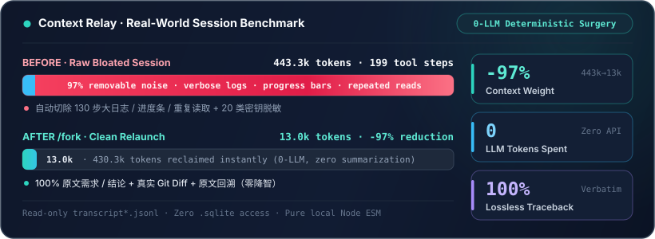

<p align="center">
  
</p>

<h1 align="center">Context Relay</h1>

<p align="center">
  <strong>Zero-UI native <code>/fork</code> for Google Antigravity — one-click denoised conversation forking, 0-token bloat nudges, deterministic Git-grounded handoffs with verbatim traceback, 20-category secret redaction, and shareable token-savings cards.</strong>
</p>

<p align="center">
  面向 Google Antigravity 的 100% 纯无感一键 <code>/fork</code> 插件：零弹窗原目录去噪重开（自动追加 <code>(fork)</code> 标题）、0-token <code>PreInvocation</code> 水位提醒、真实 Git Diff 锚定与原文无损回溯、20 类密钥脱敏、跨目录分叉与个人省流战报图。
</p>



---

## Hitting Context Limit? `/fork` vs `/compact`

Long coding sessions slow down and lose precision as verbose tool logs, progress bars, failed retries, and repeated file reads pile up. When your session gets heavy, you have two clean native choices:

| Need | Command | How It Works |
| :--- | :--- | :--- |
| **Compress in-place** (stay in the same thread) | `/compact` (Antigravity built-in) | Calls an LLM to summarize earlier turns inside the existing conversation. |
| **Lossless denoised fresh session** (zero summarization degradation) | **`/fork`** (Context Relay) | **0-LLM deterministic surgery**: strips bulky tool noise, anchors real `git status`/`git diff`, preserves 100% verbatim goals & conclusions with lossless transcript traceback, redacts 20 secret classes, inherits your model, and launches `<original title> (fork)` in one click. |

### Key Highlights (`v0.2.2`)

- **One-Click `/fork`, Zero Popups by Default**: Typing `/fork` never opens a modal or webpage — it immediately cleans your current conversation in the original project folder, reads your live sidebar renamed title (via Antigravity's plain-text `annotations/<id>.pbtxt`, zero SQLite) to append ` (fork)`, and replies with a 2-line receipt and a clickable `[Title (fork)](conversation://<id>)` instant-jump link.
- **Ultra-Clean `/` Menu**: Only `/fork` appears in Antigravity's slash-command menu (legacy `relay` and `context-relay` skills are hidden with `disable-slash-command: true`).
- **Automatic 0-Token `PreInvocation` Bloat Nudge**: `hooks/nudge.mjs` monitors transcript weight with zero LLM cost and nudges you only when context bloat crosses threshold (opt out anytime with `CONTEXT_RELAY_NUDGE=0`).
- **Cross-Project & Turn-Bounded Forking**: Run `/fork <project-keyword>` to carry curated context straight into another registered workspace (0 popups on exact match; at most 1 native `ask_question` card if ambiguous), or `/fork 第N轮` to cleanly branch from an earlier turn.
- **Personal Token Savings War-Report (`stats --svg`)**: Run `/fork stats` in chat or `node bin/context-relay.mjs stats --svg savings.svg` in terminal to track cumulative tokens saved and generate a crisp GitHub-ready SVG benchmark card.
- **Zero-Dependency Local Node ESM (`>= 22.15.0`)**: No `npm install`, no runtime dependencies, no telemetry, no cloud calls.

---

## Installation & Usage

### Prerequisites

- **Node.js `>= 22.15.0`** (pure ESM, zero external dependencies).

### 1. Install into Antigravity

**Option A — Clone directly into your global Antigravity plugins directory:**

```bash
git clone https://github.com/KennyMcSimpson/ContextRelay.git ~/.gemini/config/plugins/context-relay
```

Antigravity automatically discovers `plugin.json`, activates the `PreInvocation` bloat-nudge hook and `Stop` incremental indexer (`hooks.json`), and exposes `/fork` in your `/` menu.

**Option B — Local clone + installer CLI (supports custom data directory):**

```bash
git clone https://github.com/KennyMcSimpson/ContextRelay.git ContextRelay
cd ContextRelay

node bin/context-relay.mjs install antigravity --data-dir <custom-dir>
```

### 2. Everyday `/fork` Commands in Antigravity

| What You Type | What Happens |
| :--- | :--- |
| `/fork` | **0 popups** — immediately denoises the current conversation in the original folder, names it `<原标题> (fork)`, inherits the active model, and returns a clickable `conversation://<id>` link. |
| `/fork <目录关键词>` | Plans target workspace match (`exact` → instant `--go` with 0 popups; `ambiguous` → 1 native `ask_question` card; `not_found` → explains opening the folder once in left `Projects` or exporting). |
| `/fork 第N轮` | Deterministically forks up to turn `N` (`--until <N>`) into a clean session without later detours. |
| `/fork stats` | Shows cumulative tokens saved across forks and optionally exports a GitHub SVG war-report card (`--svg`). |
| `/fork 搜 <关键词>` | Full-text searches indexed historical sessions and returns clickable `[<标题>](conversation://<sessionId>)` links. |

### 3. Configuring Bloat Nudges

| Environment Variable | Purpose |
| :--- | :--- |
| `CONTEXT_RELAY_NUDGE=0` | Disable automatic 0-token `PreInvocation` bloat reminders completely. |

---

## CLI Reference

```bash
# 1. One-click in-place denoised fork (original folder, auto "(fork)" title)
node bin/context-relay.mjs fork --session <conversation-id> --go --json

# 2. Plan / execute cross-project or turn-bounded fork (or --export-only)
node bin/context-relay.mjs fork --session <conversation-id> --plan --to "<project-or-path>" [--until <N>] --json
node bin/context-relay.mjs fork --session <conversation-id> --go [--to "<project-id>"] [--preset smart-clean|backbone] [--until <N>] [--note "<extra-instruction>"] [--export-only] --json

# 3. View cumulative token savings & export a personal GitHub SVG war-report card
node bin/context-relay.mjs stats --json
node bin/context-relay.mjs stats --svg ./my-savings.svg --json

# 4. Full-text search across indexed historical Antigravity sessions
node bin/context-relay.mjs search "<query>" --limit 10 --json

# 5. Inspect turns & export deterministic Git-grounded handoff bundle
node bin/context-relay.mjs inspect <conversation-id>
node bin/context-relay.mjs export <conversation-id>

# 6. Install / uninstall Antigravity plugin wiring
node bin/context-relay.mjs install antigravity --data-dir <custom-dir>
node bin/context-relay.mjs uninstall antigravity
```

Run `node bin/context-relay.mjs --help` (or `<command> --help`) to inspect all supported flags.

### Optional: Offline Local Web Debugger (`serve`)

Normal Antigravity usage requires **no web UI**. For power users who want an offline browser view for local inspection or debugging, an optional loopback server remains available:

```bash
node bin/context-relay.mjs serve --port 3477
# Open http://127.0.0.1:3477
```

---

## Security & Privacy

- **100% Local, Zero-Dependency Node ESM (`>= 22.15.0`)**: No third-party runtime packages, no telemetry, and no cloud LLM calls.
- **Read-Only Transcript & Public API Boundary**: Reads only local `transcript*.jsonl` logs and interacts solely via public local `agentapi` interfaces. **Never** opens, queries, or modifies private `.sqlite` databases.
- **20-Category Built-In Secret Redaction**: Automatically detects and masks API keys, bearer tokens, cloud credentials, webhook secrets, and private key blocks before exporting or forking context.
- **Loopback & DNS-Rebinding Protection**: When the optional `serve` debugger is started, it binds strictly to loopback (`127.0.0.1` / `localhost`) and validates `Host` and `Origin` headers.

---

## Architecture & Multi-Agent Extensibility

```text
ContextRelay/
├── plugin.json                      # Antigravity root plugin manifest (v0.2.1, strict whitelist)
├── hooks.json                       # Root PreInvocation (nudge) + Stop (incremental sync) hooks
├── assets/
│   ├── logo.svg                     # Square transparent-margin plugin icon
│   └── savings-benchmark.svg        # GitHub light/dark crisp benchmark visual (820×300)
├── hooks/
│   ├── nudge.mjs                    # 0-token PreInvocation context bloat reminder
│   └── sync-turn.mjs                # Lightweight Stop-hook incremental transcript indexer
├── skills/
│   ├── fork/
│   │   └── SKILL.md                 # Primary one-click /fork slash command
│   ├── relay/
│   │   └── SKILL.md                 # Hidden backward-compatible alias (disable-slash-command: true)
│   └── context-relay/
│       └── SKILL.md                 # Hidden backward-compatible alias (disable-slash-command: true)
├── adapters/                        # Host adapter abstraction layer (Antigravity built-in)
├── core/                            # Turn parser, smart pruning, Git anchor, 20-class redactor, stats & store
├── bin/
│   └── context-relay.mjs            # Unified CLI (fork, stats --svg, search, inspect, export, install, serve)
├── server/ & ui/                    # Optional offline local web debugger (serve)
└── test/                            # Unit, security, redaction, hook, CLI & manifest tests
```

### Extending to Additional Agents (`adapters/`)

All host-specific transcript discovery, turn normalization, and clean-relaunch transport are isolated behind `adapters/`. Core surgical pruning, Git grounding, secret redaction, savings telemetry, and full-text indexing remain host-agnostic so future coding agents can plug in cleanly without rewriting core logic.

---

## Testing

```bash
node --test test/*.test.mjs
```
