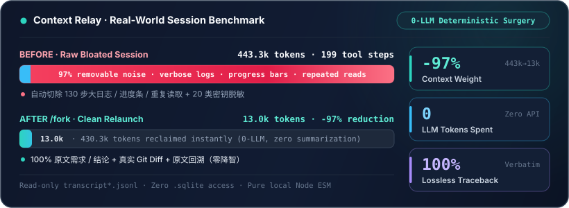
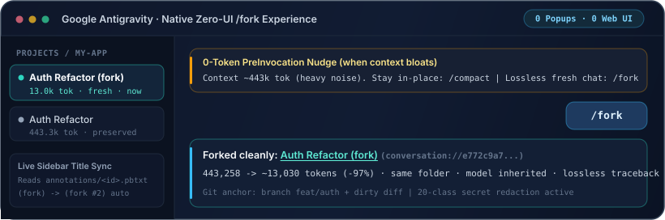

<p align="center">
  
</p>

<h1 align="center">Context Relay</h1>

<p align="center">
  <strong>面向 Google Antigravity 的 100% 纯无感原生 <code>/fork</code> 插件</strong><br/>
  一键去噪重开 · 自动继承侧边栏重命名标题 · 0-Token 水位提醒 · Git 真实状态锚定 · 原文无损回溯 · 20 类密钥脱敏
</p>

<p align="center">
  <a href="https://github.com/KennyMcSimpson/ContextRelay/actions/workflows/ci.yml"></a>
  
  = 22.15.0" />
  
  
  <a href="./LICENSE"></a>
</p>

<p align="center">
  <a href="./README.md">English</a> · <strong>简体中文</strong> &nbsp;|&nbsp;
  <a href="#快速安装">快速安装</a> ·
  <a href="#fork-与-compact-怎么选">/fork 与 /compact</a> ·
  <a href="#日常指令">日常指令</a> ·
  <a href="#安全与隐私">安全与隐私</a> ·
  <a href="./CHANGELOG.md">更新日志</a>
</p>

<p align="center">
  
</p>

---

## 为什么做 Context Relay？

长对话跑着跑着就会被海量编译日志、进度条、反复重读文件和失败重试把上下文撑爆到 300k–500k+ tokens：原地摘要容易丢失关键代码细节（降智），手动重开又要花十几分钟重新对齐上下文。

**Context Relay** 追求 **100% 原生无感融入**——不开丑陋网页、不弹繁琐复选框、不消耗额外模型额度做摘要：

<p align="center">
  
</p>

## `/fork` 与 `/compact` 怎么选？

当上下文膨胀到阈值时，内置的 **0-Token `PreInvocation` 钩子** 会在对话里给出一句极简原生提醒，提供两种互补方案：

| 你的需求 | 指令 | 原理与特点 |
| :--- | :--- | :--- |
| **原地压缩**（留在当前这条对话） | `/compact` *(Antigravity 内置)* | 调用大模型对历史轮次做摘要压缩。 |
| **无损去噪重开新对话**（绝不因摘要降智） | **`/fork`** *(Context Relay)* | **0-LLM 确定性外科去噪**：自动剔除冗余工具刷屏与重复读盘、锚定真实 `git status`/`git diff`、100% 保留原文需求与结论并附带 `transcript_full.jsonl` 无损回溯锚点、20 类密钥脱敏、实时读取你在侧边栏改好的对话名、沿用原模型一键开出 `<现标题> (fork)`。 |

### 核心特性（`v0.2.2`）

- **真正一键 `/fork`，默认零弹窗**：直接输入 `/fork`，自动在原项目目录去噪重开，只回复 2 行精炼回执与原生可直跳的 `[标题 (fork)](conversation://<id>)` 链接。
- **实时继承侧边栏重命名标题（零触碰 `.sqlite`）**：只读解析 Antigravity 纯文本注解 `annotations/<id>.pbtxt`，你在左侧改好的名字会被精准保留并智能递增（`反重力插件-1` → `反重力插件-1 (fork)` → `反重力插件-1 (fork #2)`）。
- **极简 `/` 菜单**：`/` 菜单里只露唯一的 `/fork`（旧别名自动隐藏，不占视野）。
- **0-Token 自动水位提醒**：`hooks/nudge.mjs` 不花模型 token，仅在上下文显著膨胀时发轻量提醒，且自动过滤子代理（随时可设 `CONTEXT_RELAY_NUDGE=0` 关闭）。
- **跨目录分叉 & 指定轮次切分**：`/fork <目录关键词>` 把精炼上下文直接带去另一个项目目录继续干活；`/fork 第N轮` 干净切掉后面走偏的弯路。
- **个人省流战报图（`stats --svg`）**：对话里打 `/fork stats` 查看累计省下的 Token，终端加 `--svg` 一键导出可贴上 GitHub 的专属战报矢量图。
- **零外部依赖、100% 本地运行**：纯 Node.js ESM（`>= 22.15.0`），无需 `npm install`，零遥测、零云端上报。

---

## 快速安装

### 环境要求

- **Node.js `>= 22.15.0`**（零第三方依赖）。

### 方式 A：直接克隆到 Antigravity 全局插件目录（推荐）

```bash
git clone https://github.com/KennyMcSimpson/ContextRelay.git ~/.gemini/config/plugins/context-relay
```

Antigravity 会自动发现 `plugin.json`，挂载 `PreInvocation` 水位提醒与 `Stop` 增量同步钩子（`hooks.json`），并在 `/` 菜单里暴露 `/fork`。

### 方式 B：克隆到本地后用安装器自定义数据目录（适合把缓存放到非系统盘）

```bash
git clone https://github.com/KennyMcSimpson/ContextRelay.git ContextRelay
cd ContextRelay

node bin/context-relay.mjs install antigravity --data-dir <自定义数据目录>
```

---

## 日常指令

| 在 Antigravity 里输入 | 实际效果 |
| :--- | :--- |
| `/fork` | **0 弹窗** — 立刻在原项目目录去噪重开，沿用侧边栏现名追加 `(fork)`，继承当前模型，返回可点击直跳链接。 |
| `/fork <目录关键词>` | 规划目标工作区匹配（精确命中 0 弹窗直飞；多个候选仅弹 1 次原生 `ask_question` 选择；未注册项目给出清晰引导或仅导出交接包）。 |
| `/fork 第N轮` | 按轮次确定性截断至第 `N` 轮重开干净新对话。 |
| `/fork stats` | 查看累计帮自己省了多少 Token，支持导出个人 GitHub 战报图。 |
| `/fork 搜 <关键词>` | 全文检索历史会话（含侧边栏改名后的标题）并给出原生直跳链接。 |

### 环境变量开关

| 变量 | 说明 |
| :--- | :--- |
| `CONTEXT_RELAY_NUDGE=0` | 彻底关闭 0-Token `PreInvocation` 自动水位提醒。 |
| `CONTEXT_RELAY_DATA_DIR=<目录>` | 自定义本地索引、交接归档与统计数据存放目录。 |

---

## 命令行参考

```bash
# 1. 原目录一键去噪重开（自动继承侧边栏现名 + "(fork)"）
node bin/context-relay.mjs fork --session <conversation-id> --go --json

# 2. 跨项目分叉 / 指定轮次截断 / 仅导出交接包
node bin/context-relay.mjs fork --session <conversation-id> --plan --to "<目录或项目名>" [--until <N>] --json
node bin/context-relay.mjs fork --session <conversation-id> --go [--to "<project-id>"] [--preset smart-clean|backbone] [--until <N>] [--note "<附加要求>"] [--export-only] --json

# 3. 查看累计省流统计 & 导出个人 GitHub SVG 战报图
node bin/context-relay.mjs stats --json
node bin/context-relay.mjs stats --svg ./my-savings.svg --json

# 4. 全文检索历史 Antigravity 对话
node bin/context-relay.mjs search "<关键词>" --limit 10 --json

# 5. 安装 / 卸载本机 Antigravity 插件
node bin/context-relay.mjs install antigravity --data-dir <自定义目录>
node bin/context-relay.mjs uninstall antigravity
```

---

## 安全与隐私

- **零依赖、100% 本地**：纯 Node.js ESM（`>= 22.15.0`），不联网拉包、不调用任何云端 API。
- **严守只读边界（零碰 `.sqlite`）**：只读 `transcript*.jsonl` 与纯文本 `annotations/<id>.pbtxt`，仅通过公开本地 `agentapi` 交互，**绝不打开或修改任何私有 `.sqlite` / `.db` 数据库**。
- **内置 20 类密钥脱敏**：导出或分叉前自动脱敏各类 API Key、GitHub/AWS/Slack/HF/npm Token、Bearer/Basic 鉴权头、数据库连接串与 PEM 私钥块。
- **跨进程原子锁（零删除 API）**：基于内核 `openSync('wx', 0o600)` + 原子改名释放 + 僵尸锁回收，经 Windows 8 并发 200/200 零丢写压测验证。

---

## 测试

```bash
node --test test/*.test.mjs
```

## 许可

[MIT](./LICENSE) © 2026 KennyMcSimpson
